# Hex board view

Hex board game renderer built on [PixiJS](https://pixijs.com/).

Can show Red or Blue stones, can be rotated, last move played, mark swap move, show coords, add custom marks...

<p>
    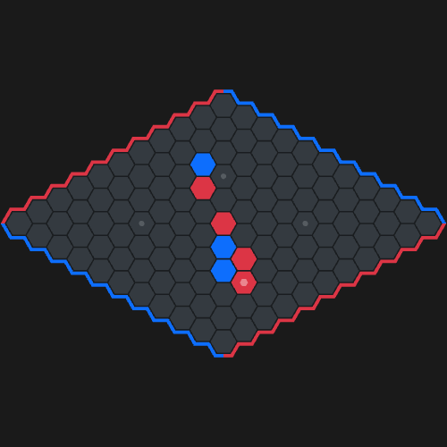
    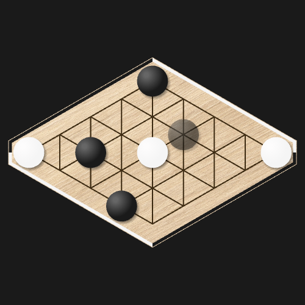
</p>

## Installation

```bash
npm install @playhex/pixi-board pixi.js tiny-typed-emitter
```

`pixi.js` and `tiny-typed-emitter` are peer dependencies and must be installed alongside the package.

`tiny-typed-emitter` relies on node `events` module: when bundling for the browser, also install `events` (`npm install events`) so your bundler can resolve it.

### Optional entry points

Some facades live in separate entry points, so their dependencies are only needed if you use them:

| Entry point | Exports | Requires |
|---|---|---|
| `@playhex/pixi-board/conditional-moves` | `ConditionalMovesFacade` | `npm install @playhex/conditional-moves` |
| `@playhex/pixi-board/shading-patterns` | `ShadingPatternFacade` | `npm install @playhex/shading-patterns` |

## Quick start

```html
<div id="board" style="width: 600px; height: 400px"></div>
```

```ts
import { GameView } from '@playhex/pixi-board';

const gameView = new GameView(9);
await gameView.mount(document.getElementById('board'));

gameView.setStone('d4', 0); // red stone
gameView.setStone('e6', 1); // blue stone
```

<p>
    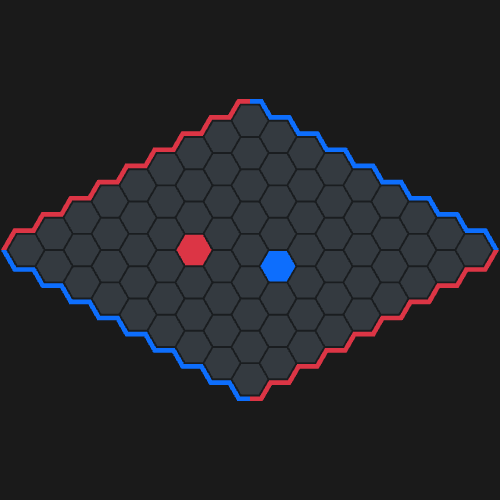
</p>

The container must have a fixed size (see below). The default theme is dark, see Theming below to use the light theme.

## Usage

### GameView

The class `GameView` provides a board that can be manipulated at low level:

- add/remove stones
- handle rotation
- add marks: show letters, numbers, or symbol on a cell
- themes: light or dark theme, custom themes from json or typescript

#### Conventions

**Players**:

- `0`: red (or black), first player, connects top to bottom
- `1`: blue (or white), second player, connects left to right

**Coords**:

Formating is lowercase, letter then number, start from `a1`.

Ordering is:

```
a1  b1  c1
  a2  b2  c2
    a3  b3  c3
```

<p>
    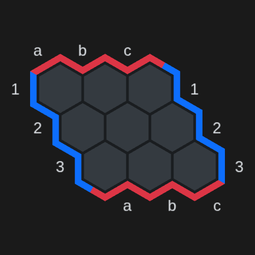
</p>

#### Examples

- Simple example: show an empty board and add to the dom

``` ts
import { ref, onMounted } from 'vue';
import { GameView } from '@playhex/pixi-board';

const gameView = new GameView(9);
const myElement = ref();

onMounted(async () => {
    if (!myElement.value) {
        throw new Error('Missing element with ref="myElement"');
    }

    await gameView.mount(myElement.value);
});
```

Important, the element where the GameView is mounted must have fixed size, example:

``` html
<div ref="myElement" class="game-view-container"></div>
```

``` css
.game-view-container {
    width: 400px;
    height: 300px;
}
```

This fixed size is important because the board resizes automatically
when the element size changes.
If the size is not fixed, the board may overflow, grow the element size,
resize the board, overflow again... and the board and the element will grow indefinitely.

Though the element can be resized without any problem, the board will resize to fit the element.

- Add a blue stone and a red stone

``` ts
gameView.setStone('d4', 0);
gameView.setStone('e6', 1);
```

red now has a stone on d4, blue has a stone on e6.

<p>
    
</p>

- Show coords

``` ts
gameView.toggleDisplayCoords(); // hide/show coords
gameView.setDisplayCoords(); // show coords
gameView.setDisplayCoords(false); // hide coords
```

<p>
    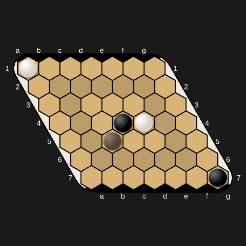
</p>

- Rotate board

Board can be displayed in 12 rotations.
Starting from 0: flat.
Will turn clockwise by 30° every increment.
Provided rotation will modulo 12, so providing -1, 11 or 23 is same.

``` ts
gameView.setOrientation(0); // show board in flat orientation
gameView.setOrientation(11); // show board in diamond orientation
gameView.setOrientation(9); // show board in portrait orientation

// or use constants for better readability
gameView.setOrientation(GameView.ORIENTATION_FLAT);
gameView.setOrientation(GameView.ORIENTATION_DIAMOND);
gameView.setOrientation(GameView.ORIENTATION_PORTRAIT_FLAT);

// or use weird orientations
gameView.setOrientation(1.6);
```

Diamond and flat orientations:

<p>
    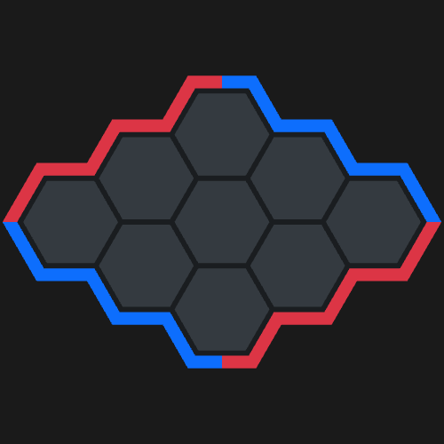
    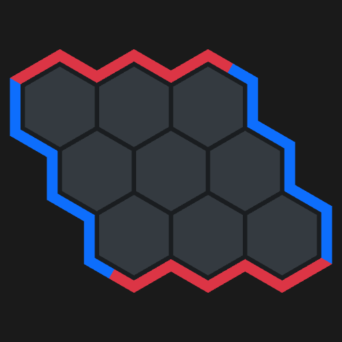
</p>

- Highlight sides

It's possible to make sides faded. It is used to show who is currently playing.
By default, sides are "highlighted", but we can unhighlight (fade) sides with:

``` ts
gameView.highlightSides(true, false); // highlight red side, but fade blue side
gameView.highlightSides(false, false); // makes all sides faded
gameView.highlightSideForPlayer(1); // highlight sides for blue, fade red sides
```

#### Partial board

Some cells can be hidden, or only some cells displayed to show a partial board (i.e a puzzle on a corner of the board).
Hidden cells are not drawn, nor stones and marks on them, and cannot be clicked.
Stones are still there: `getStone()` still returns them.
Board is zoomed to fit displayed cells, and coords are displayed around them.

``` ts
gameView.setCellsMask(CellsMask.hiding(9, ['d4', 'e5'])); // display all cells except d4 and e5
gameView.setCellsMask(CellsMask.showingOnly(9, ['a1', 'a2', 'b1', 'b2'])); // display only these cells
gameView.setCellsMask(CellsMask.all(9)); // display whole board again

gameView.getCellsMask().isVisible('a1');

// or from constructor
new GameView(9, {
    cellsMask: CellsMask.showingOnly(9, ['a1', 'a2', 'b1', 'b2']), // or CellsMask.hiding(9, [...])
});
```

Some hidden cells, corners of a board displayed for a puzzle, and a ziggurat on bottom edge:

<p>
    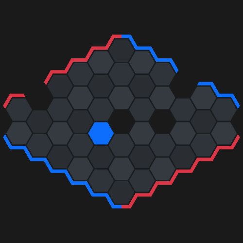
    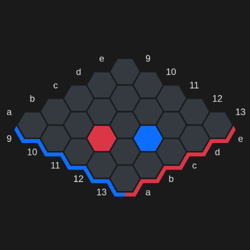
    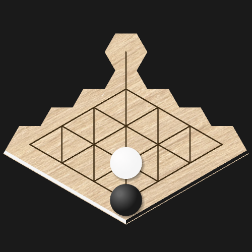
    
</p>

#### Edge arrow mark

Arrow pointing towards an edge of the board: `'top'` or `'bottom'` (red edges), `'left'` or `'right'` (blue edges),
e.g to show a stone is connected to this edge. Rotates with the board.

``` ts
import { EdgeArrowMark } from '@playhex/pixi-board';

gameView.addEntity(new EdgeArrowMark('top').setCoords('c2'));

// optional color, defaults to white
gameView.addEntity(new EdgeArrowMark('right', 0xffff00).setCoords('d3'));
```

<p>
    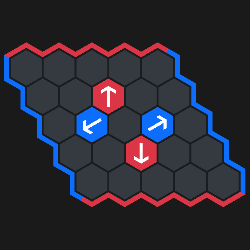
    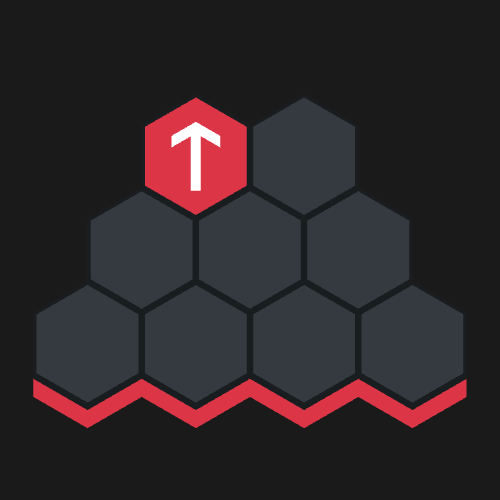
</p>

#### Theming

Board appearance is customizable with themes, created from json or in typescript.
Default theme is PlayHex dark theme, others are builtin (`gobanTheme`, `hexworldTheme`, `polishNostalgiaTheme`):

``` ts
import { GameView, gobanTheme, resolveTheme } from '@playhex/pixi-board';

await gameView.setTheme(resolveTheme(gobanTheme, 'dark'));
```

Goban, HexWorld and Polish nostalgia themes:

<p>
    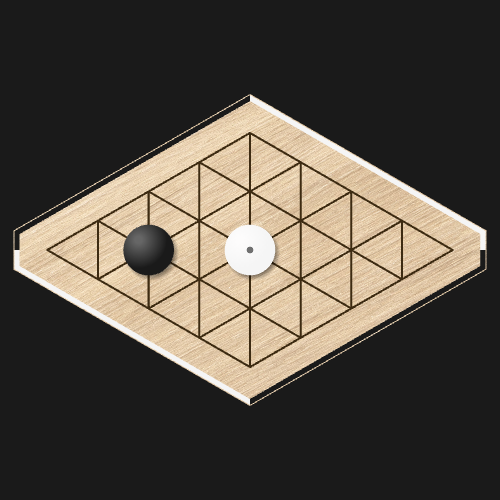
    
    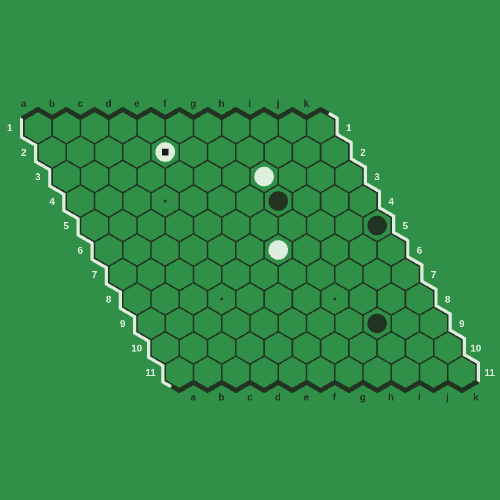
</p>

See [THEMING.md](THEMING.md) to use, create and customize themes.

### Facades

As the `GameView` provides a low level API, **facades** provide higher level methods.

Generally, facades take a GameView instance as argument,
and provide methods to manipulate the GameView to do more things than just adding a single stone.

#### PlayingGameFacade

Can play a game, add stones alternatively, shows last move mark, swap move, can preview next move (used for move confirm or premove).

``` ts
import { GameView, PlayingGameFacade } from '@playhex/pixi-board';

const gameView = new GameView(9);
const playingGameFacade = new PlayingGameFacade(gameView);

playingGameFacade.addMove('b3'); // first player, red, plays b3. Blue can swap, so show a mark "swappable"
playingGameFacade.addMove('swap-pieces'); // second player, blue, swaps. Shows a mark "swapped"
playingGameFacade.addMove('f5'); // red plays f5. Add a mark to show last move

playingGameFacade.undoLastMove(); // undo last move, reset position to one move earlier

playingGameFacade.destroy(); // when finished
```

Swappable first move, then swapped:

<p>
    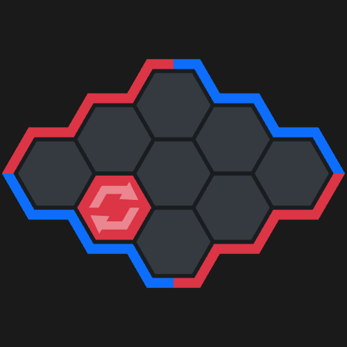
    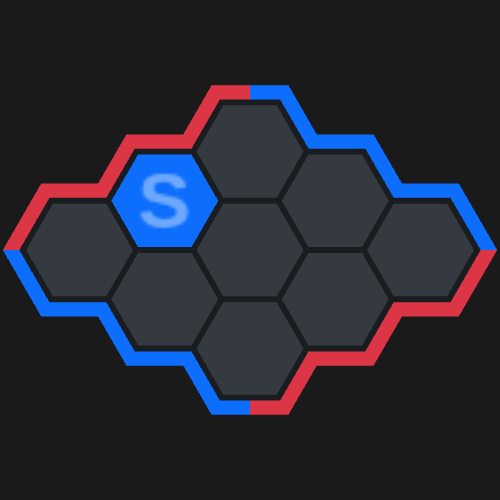
</p>

This facade also have a "view pause" feature to allow adding move without updating the view.

Moves are kept in memory until the view is resumed: all moves played (or undone) while pause are added.

This is used to prevent adding stones while doing a simulation with another facade.

``` ts
const playingGameFacade = new PlayingGameFacade(gameView);

playingGameFacade.addMove('b3'); // add stone
playingGameFacade.pauseView(); // pause view
playingGameFacade.addMove('f5'); // add stone, but do not show it yet
playingGameFacade.resumeView(); // resume view, show f5 stone
```

Preview move, to show a faded stone.

``` ts
playingGameFacade.setPreviewedMove('a1', 0); // red preview their move at a1
playingGameFacade.setPreviewedMove('d4', 1); // removes previous preview, now blue preview their move at a1
```

<p>
    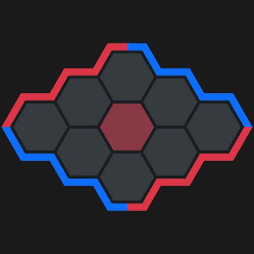
</p>

Preview move also handles swap move preview.

``` ts
playingGameFacade.addMove('a2');
playingGameFacade.setPreviewedMove('swap-pieces', 1); // a2 is hidden, b1 is previewed to visualize where will be swapped stone

playingGameFacade.removePreviewedMove(); // cancels preview
```

<p>
    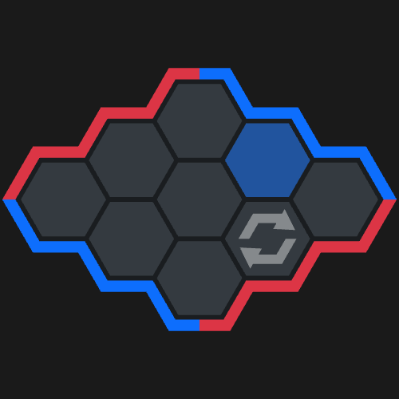
</p>

#### ConditionalMovesFacade

This facade allows to register conditional moves.

It will pause the view, let player simulates many lines, edit/remove lines, and submit it.
On submit, it returns an array with conditional moves lines.

State and editor come from [`@playhex/conditional-moves`](https://github.com/playhex/playhex/tree/master/src/packages/conditional-moves), an optional peer dependency that must be installed to use this facade.

``` ts
import { GameView, PlayingGameFacade } from '@playhex/pixi-board';
import { ConditionalMovesFacade } from '@playhex/pixi-board/conditional-moves';
import { createConditionalMovesState, ConditionalMovesEditor } from '@playhex/conditional-moves';

const gameView = new GameView(9);
const playingGameFacade = new PlayingGameFacade(gameView);

/**
 * Create a state.
 *
 * State is a plain object, designed to be stored/reused between editions,
 * and be used as a vue ref.
 *
 * From the point of view of red:
 */
const state = createConditionalMovesState(0);

/**
 * Takes a state, allows editing it.
 */
const editor = new ConditionalMovesEditor(state);

/**
 * Then instanciate the facade.
 *
 * It will pause the view and start edition.
 */
const conditionalMovesFacade = new ConditionalMovesFacade(playingGameFacade, editor);

/**
 * Submit conditional moves lines.
 * It will save lines, and emit a 'conditionalMovesSubmitted' event
 * with submitted lines.
 */
editor.submitConditionalMoves();

/**
 * Once done, disable conditional moves edition. Will resume the view.
 */
conditionalMovesFacade.destroy();
```

#### ShadingPatternFacade

This facade applies a shading pattern on the board: each cell gets a shading level, to help reading the board.

Patterns come from [`@playhex/shading-patterns`](https://github.com/playhex/playhex/tree/master/src/packages/shading-patterns), an optional peer dependency that must be installed to use this facade:

``` bash
npm install @playhex/shading-patterns
```

``` ts
import { GameView } from '@playhex/pixi-board';
import { ShadingPatternFacade } from '@playhex/pixi-board/shading-patterns';

const gameView = new GameView(11);
const shadingPatternFacade = new ShadingPatternFacade(gameView);

/**
 * Available patterns:
 * 'tricolor_checkerboard', 'concentrical_rings', 'height_5_lines', 'single_ring', 'custom',
 * or null to remove shading.
 *
 * Second argument is the intensity, in [0, 1], defaults to 0.5.
 */
shadingPatternFacade.setShadingPattern('concentrical_rings', 0.5);

/**
 * Custom pattern from a math expression,
 * with variables: row, col, size, distToSide
 */
shadingPatternFacade.setShadingPattern('custom', 0.5, '(row + col) % 2');

/**
 * Remove shading.
 */
shadingPatternFacade.setShadingPattern(null);
```

<p>
    
    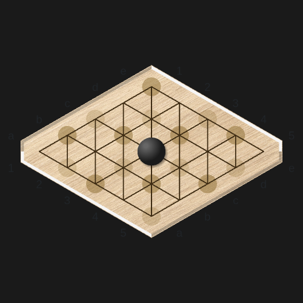
</p>

## Testing

### Unit tests

``` bash
npm run test:unit
```

### Visual tests

Renders board snapshots in a headless browser and compares them against reference images.

``` bash
npm run test:visual
```

- `cypress/screenshots-expected`: how board view should looks like
- `cypress/screenshots`: how board view appeared while being under test

**Note**: If a new visual test is added,
expected screenshots will be automatically added in folder on first run.

If board appearance changed from expected screenshot, but it's not a regression,
validate changes and update reference screenshots with:

``` bash
npm run test:visual:update
```

## License

This package is under [AGPL-3.0 license](LICENSE).
